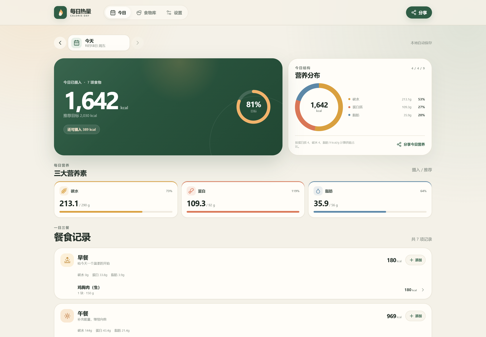
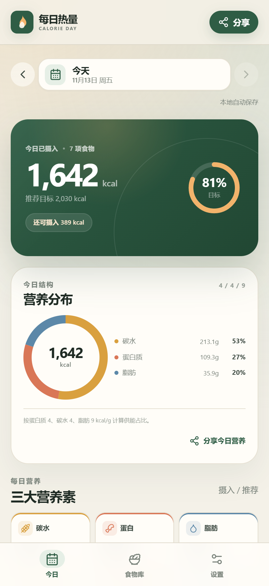
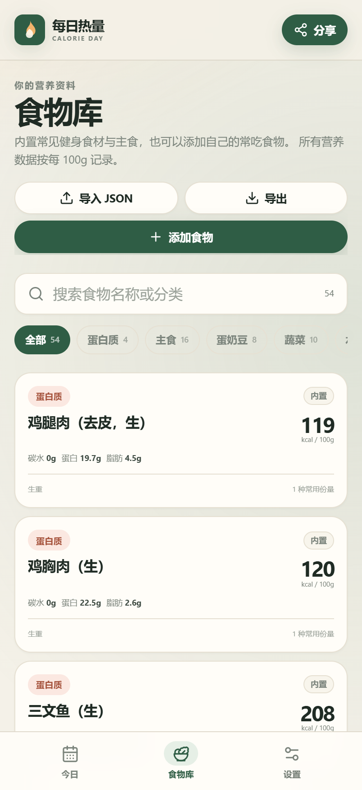
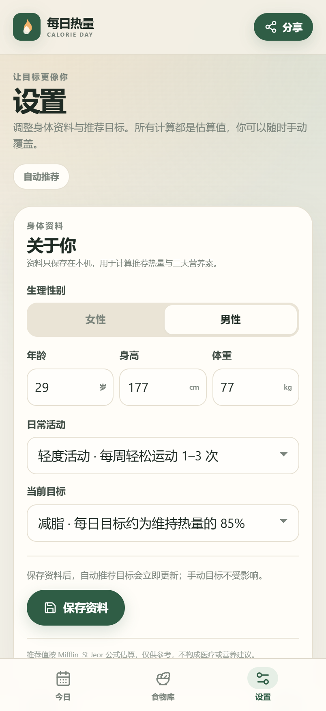
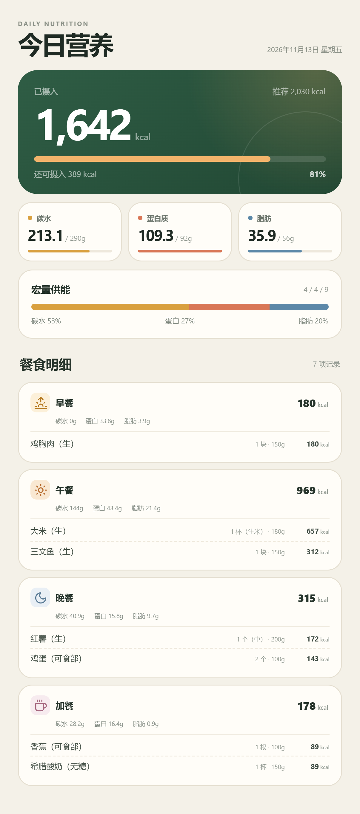

# 每日热量 · Calorie Day

一个中文、移动端优先、纯前端的每日热量与营养记录应用。

记录每天吃了什么，查看热量、三大营养素和目标进度；数据默认只保存在当前浏览器——无需注册，没有后端，也不会上传饮食记录。

[在线使用](https://easteden.github.io/calorie-day/) · [数据模型](docs/data-model.md) · [问题反馈](https://github.com/EastEden/calorie-day/issues) · [MIT License](LICENSE)

<p align="center">
  
</p>

## 创作初衷

市面上的饮食记录 App 很多，而对于我们自己做饭的人而言，实际上只需要记录每天的食材，以及备餐情况而已。因此，这个项目只保留最必要的记录和查看功能：不注册、不联网、不打扰，数据不上传，纯本地。

注意：由于数据完全不上传，一旦你的浏览器清了 COOKIE 和 LOCAL STORAGE，就有数据丢失的风险，因此请自行通过设置做好数据备份。

如果遇到需要拍照识别或自然语言整理的情况，用你习惯的 AI 工具识别，再通过 JSON 导入即可。

## 特点

- **记录快**：四餐分开记录，支持按克或按常见份量填写。
- **快捷入口**：早餐可快速记咖啡和配料，午 / 晚餐可快速记烹饪油。
- **越用越顺手**：最近使用的食物自动置顶，并显示「最近」标记。
- **为一次做一大份准备**：备餐可以组合多种食材、分成多份，再跨餐次、跨天记录。
- **看见营养结构**：热量、碳水、蛋白质、脂肪，目标进度和宏量供能占比一目了然。
- **看见长期趋势**：7 天 / 30 天热量趋势，柱体按碳水、蛋白质、脂肪的供能组成拆分，并附每日明细表；7 天模式下可点击柱体查看当天各营养素克数。
- **历史保持稳定**：每条记录保存食物、目标和体重快照，之后修改食物库或体重不会改写过去。
- **AI 只做输入工具**：拍照识图或自然语言整理交给其他 AI，按 JSON 导入，不在 App 内堆模型和权限。
- **数据可带走**：支持食物库 JSON、AI 饮食记录 JSON 和全量备份导入导出。
- **一键分享**：生成包含三餐明细和营养总览的长图。

## 界面预览

| 今日记录 | 食物库 |
| --- | --- |
|  |  |

| 设置 | 分享图 |
| --- | --- |
|  |  |

更多截图位于 [`screenshots/`](screenshots/)。

## 快速开始

环境要求：

- Node.js **18.14+**
- npm **9+**

```bash
git clone https://github.com/EastEden/calorie-day.git
cd calorie-day
npm install
npm run dev
```

打开：

```text
http://localhost:5173/
```

开发服务器固定使用 `localhost:5173` 并开启 `strictPort`。如果端口被占用会直接报错，不会自动换端口，避免浏览器数据落到新的存储来源。

### 常用命令

| 命令 | 作用 |
| --- | --- |
| `npm run dev` | 启动开发服务器 |
| `npm run typecheck` | TypeScript 类型检查 |
| `npm test` | 运行 Vitest 测试 |
| `npm run test:watch` | 监听测试 |
| `npm run build` | 类型检查并生成生产构建到 `dist/` |
| `npm run preview` | 预览生产构建 |

## 功能说明

### 日常记录

- 早餐、午餐、晚餐、加餐分别记录。
- 每条食物支持按克或按食物自带份量记录。
- 修改或删除记录后，全天热量和营养素立即重算。
- 支持切换历史日期，历史日期只用于查看和补录。

### 快捷记录

- 早餐：一键记录黑咖啡，可选牛奶、糖、代糖、咖啡奶油，并按常见份量计算。
- 午餐 / 晚餐：一键记录食用油，默认 5g，可选 10g / 15g 或自定义。
- 加餐不显示食用油快捷入口。

### 最近使用

- 成功添加食物后，该食物进入「最近使用」。
- 最多保留 8 项，在食物选择、快速用油和备餐食材选择中优先置顶。
- 仅保存在当前浏览器，不参与备份或跨设备同步。

### 备餐

适合一次做好一大份、分成多餐吃的情况。

- 选择多种食材作为一组，填写各自重量和总份数。
- 每份重量由总重量和份数自动计算。
- 可以记录到任意日期、任意餐次，支持“今晚做好、明早吃”。
- 剩余量根据所有已记录份量自动计算。
- 吃完或点击「确认吃完」后，自动从进行中列表移除。
- 「确认吃完」只清空剩余，不会增加热量摄入。

### 目标与历史快照

- 根据性别、年龄、身高、体重、活动量和目标生成推荐热量与三大营养素。
- 支持手动覆盖目标，也可恢复自动推荐。
- 每日记录保存当时的目标和体重快照：
  - 修改当前体重后，历史日期保持原目标；
  - 当天已有记录会同步到新目标；
  - 新日期使用当前目标。

### 食物库

- 内置 59 项常见食物，覆盖蛋白质、主食、蛋奶豆、蔬菜、水果、坚果油脂、调味品和黑咖啡。
- 支持搜索、分类、自定义、编辑、删除。
- 营养值按每 100g 保存；每条记录保存营养快照，修改或删除食物不会影响历史记录。
- 第一版使用生重 / 干重 / 商品状态基准，熟重版本暂未加入。

## 数据导入与迁移

### 食物库 JSON

用于批量添加或分享普通食物库。备餐不会出现在食物库列表和食物库 JSON 导出中。

- 格式版本：`schemaVersion: 1`
- 食物名称使用语言映射，例如 `"names": { "zh-CN": "鸡胸肉" }`
- `zh-CN` 必填，其他语言可选。
- 支持按 ID 或名称识别冲突，可在导入前预览并选择是否覆盖。
- 只处理普通食物库，不包含备餐和每日饮食记录。

格式说明：

- [`docs/food-import.schema.json`](docs/food-import.schema.json)
- [`docs/sample-foods.json`](docs/sample-foods.json)

### 从其他 AI 导入饮食记录

适合用其他 AI 工具拍照识图或记录后，把结果导回本应用。

不需要在 App 内接入模型：你可以使用任何支持拍照识图或文本整理的 AI 工具，让它按下面的格式输出 JSON，再粘贴导入。

- 在今日记录页点击「导入记录」。
- 复制弹窗内置的提示词给其他 AI。
- 提示词要求 AI 只输出一个紧凑单行的 json 代码块，方便使用聊天界面自带的复制按钮；导入器也能识别并去掉代码块标记。
- AI 按指定格式输出 JSON 后，粘贴回来校验并预览。
- 支持「尝试修复并校验」，可处理中文引号、Markdown 代码块、转义括号、缺失空餐次等常见 AI 格式问题。
- 支持单天 / 多天的早餐、午餐、晚餐和加餐。
- 多天记录时，提示词会要求 AI 先向用户确认输出日期范围。
- 营养按本次摄入总量填写；导入后写入当天记录快照，**不会创建食物库条目**。
- 同一天已有记录时，按餐次追加合并，不覆盖已有记录。

格式说明：

- [`docs/meal-import.schema.json`](docs/meal-import.schema.json)

### 全量备份

设置页提供完整数据备份：

- 完整食物库。
- 指定日期范围内的每日记录。
- 个人资料和目标设置。
- 备餐元数据与历史目标 / 体重快照。

导入采用安全合并：只补充缺失的食物 ID 和日期记录，不覆盖已有数据。备份格式为 `backupVersion: 1`，不能和食物库 JSON 混用。

## 数据与隐私

### 本地优先

- 主要数据保存在浏览器 **IndexedDB**，数据库名为 `calorie-day`。
- 最近食物保存在 `localStorage`。
- 没有账号、后端或云同步，饮食记录不会上传到服务器。
- 在线站点只托管静态代码，数据仍然属于访问者自己的浏览器。

### 数据保留范围

在**同一浏览器、同一网址、普通浏览模式**下，刷新、关闭标签页、重启浏览器后记录仍会保留。

以下情况数据可能丢失或读不到：

- 清理浏览器站点数据 / 网站存储。
- 使用无痕模式并在关闭后清理。
- 更换浏览器、浏览器用户配置或设备。
- 更换域名、端口，或混用 `localhost` 与 `127.0.0.1`。
- 浏览器在存储压力下回收站点数据。

设置页提供「申请持久存储」按钮，可降低浏览器自动回收的概率，但不能替代备份或后端。重要数据建议定期导出全量备份。

## 技术栈

| 层 | 技术 |
| --- | --- |
| UI | React 18、TypeScript 5.7 |
| 构建 | Vite 5 |
| 校验 | Zod |
| 本地数据库 | IndexedDB |
| 国际化 | i18next（当前仅 zh-CN） |
| 图标 | lucide-react |
| 分享图 | html-to-image |
| 测试 | Vitest、jsdom、fake-indexeddb |

### 架构边界

- `domain/`：类型、Zod schema、营养与目标计算、日期和记录工厂。
- `data/`：IndexedDB Repository、种子食物、存储信息。
- `state/`：应用级状态、写入编排、导入导出动作。
- `features/`：今日记录、食物库、设置、首次引导、分享图。
- `ui/`：通用 Button、Modal、Toast 等组件。

数据访问通过 `CalorieRepository` 接口隔离，未来可以替换为 HTTP Repository 接入后端，而不需要改动页面。

## 项目结构

```text
src/
  app/          应用外壳、顶部导航、底部导航
  data/         IndexedDB 实现、种子食物、存储信息
  domain/       类型、Zod 校验、营养/目标计算、日期与记录工厂
  features/     记录、食物库、设置、首次引导、分享图
  i18n/         i18next 初始化、zh-CN 资源和 React hook
  state/        应用级状态、IndexedDB 写入编排
  styles/       设计 token 与页面样式
  test/         测试环境设置
  ui/           通用组件
docs/           数据模型与 JSON 格式文档
screenshots/    界面截图
```

## GitHub Pages 部署

正式站点：**https://easteden.github.io/calorie-day/**

- 工作流：[`.github/workflows/deploy-pages.yml`](.github/workflows/deploy-pages.yml)
- 推送到 `main` 后自动运行测试、构建并发布 `dist/`。
- Pages Source 需设置为 **GitHub Actions**。
- GitHub Actions 构建时 Vite 使用 `/calorie-day/` 作为 base；本地开发仍使用 `/`。
- 站点是公开项目页，但饮食数据只保存在访问者自己的浏览器中。
- `localhost` 与 Pages 域名属于不同存储来源，迁移数据请使用全量备份导入 / 导出。

## 已知限制

- 纯前端数据不具备跨设备同步能力。
- 没有历史趋势图、计划摄入、熟重食物库、登录或云同步。
- 营养数据为常见参考值，实际热量受品种、可食部、品牌和烹饪方式影响。
- 分享图使用 DOM 转 Canvas，极长内容受浏览器 Canvas 限制；iPhone Safari 的下载行为建议在真机确认。
- 备餐创建后暂不支持直接修改总重量 / 总份数，需要删除后重新创建。
- 备餐不会出现在普通食物库列表和食物库 JSON 导出中；吃完或确认吃完后，底层备餐食物会自动删除，历史饮食快照保留。全量备份仍包含进行中的备餐。
- AI 饮食记录导入的营养准确性取决于外部 AI 的识别和估算。
- 趋势页支持 7 天 / 30 天，暂不支持自定义范围或体重趋势；平均值只统计有记录且已完成日期，今日作为进行中展示。
- 当前界面仅提供简体中文。

## 文档

- [数据模型](docs/data-model.md)
- [食物库导入格式](docs/food-import.schema.json)
- [食物库示例](docs/sample-foods.json)
- [饮食记录 AI 导入格式](docs/meal-import.schema.json)

## License

本项目使用 [MIT License](LICENSE)。

你可以自由使用、修改、分发和商用，只需保留版权声明和许可证文本；软件按“原样”提供，不附带担保。

---

如果这个项目对你有帮助，欢迎 Star ⭐
