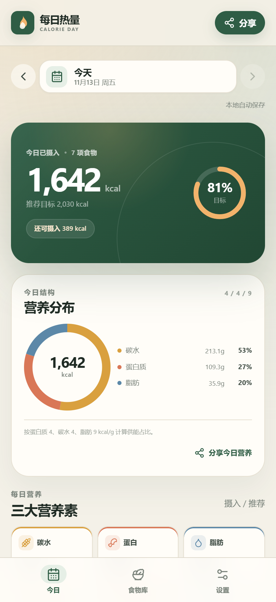
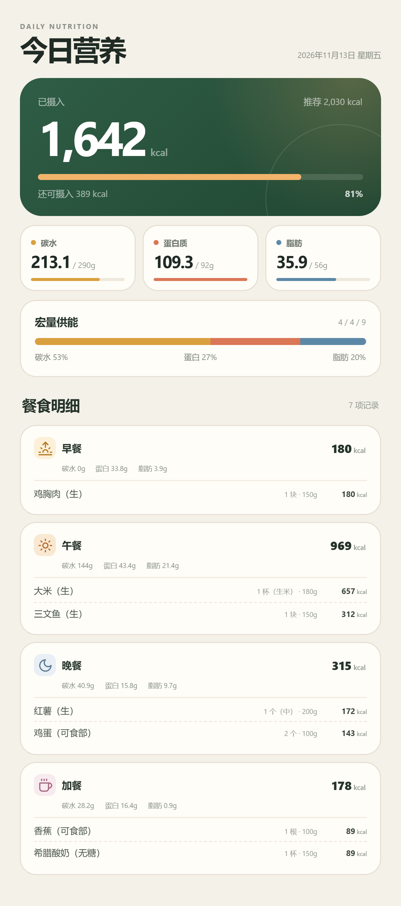

# 每日热量 · Calorie Day

一个纯前端、中文界面、移动端优先的每日卡路里记录 Web App。

使用 **React 18 + TypeScript + Vite** 开发。每日记录、身体资料和食物库通过
**IndexedDB** 保存在当前浏览器中，并针对未来接入后端做了领域模型和 Repository
分层。

## 功能

- 按日期记录早餐、午餐、晚餐和加餐，每餐支持多条食物。
- 早餐提供「咖啡」快捷键：按常见份量记录一杯黑咖啡，并可加入牛奶、糖、代糖或咖啡奶油；午 / 晚餐保留「油」快捷键，加餐不显示食用油快捷入口。
- 按克或按常用份量（如「1 块」「1 个」「1 杯」）记录摄入量。
- 食物选择界面自动把最近使用过的食物置顶，并显示「最近」标记；最多保留 8 项。
- 大份菜备餐：从「餐食记录」标题下的轻量入口进入，记录总量和每份重量；可以分多次、跨餐次和跨天记录，剩余量自动计算。
- 备餐支持直接丢弃剩余部分，丢弃不计入热量摄入；也可以跨天安排到未来日期的某一餐。
- 自动计算全天热量、碳水化合物、蛋白质、脂肪，以及分餐小计和宏量供能占比。
- 根据身体资料生成推荐热量与三大营养素目标，并支持手动覆盖。
- 当天实际摄入 vs 推荐目标的对比、剩余热量、目标完成度。
- 每日记录保存当时的目标和体重快照；修改当前体重不会改写历史日期的目标，当天目标会同步更新。
- 历史日期切换。
- 食物库：56 项内置常见食物（含橄榄油、花生油、黑咖啡），支持搜索、分类、自定义、编辑、删除。
- 食物库 JSON 导入 / 导出，带格式校验、冲突预览和覆盖开关。
- 全量备份导出 / 导入：完整食物库、可选日期范围内的每日记录、个人资料与目标设置。
- 食物名称使用带 `zh-CN` 兜底的多语言映射，为之后的语言切换和前后端分离预留结构。
- 分享图：固定 **1206px** 宽、高度随内容增长的竖版 PNG，包含营养总览与三餐明细。
- IndexedDB 即时持久化、加载门禁、写入校验、跨标签页修订号冲突保护。
- 仅本地测试环境显示的全局数据重置工具。
- 基于 i18next 的国际化基础，当前仅提供简体中文（zh-CN）。

## 界面预览

| 今日记录 | 分享图 |
| --- | --- |
|  |  |

更多截图位于 [`screenshots/`](screenshots/)。

## 快速开始

环境要求：

- Node.js **18.14+**
- npm 9+

```bash
npm install
npm run dev
```

打开：

```text
http://localhost:5173/
```

开发服务器固定使用 `localhost:5173` 且开启 `strictPort`。端口被占用时会直接报错，
不会自动切换端口，避免产生新的浏览器存储来源。

其他命令：

```bash
npm run typecheck
npm test
npm run build
npm run preview
```

## 使用方式

1. 首次打开完成身体资料设置，生成每日推荐目标。
2. 在早餐、午餐、晚餐、加餐中点击「添加」，从食物库选择食物并填写分量；早餐可用「咖啡」快速记录咖啡与配料，午 / 晚餐可用「油」快速记录烹饪用油。
3. 点击已记录的食物可以修改分量或删除。
4. 做了大份菜时，点击「餐食记录」标题下的「备餐」入口，选择食物、填写总重量和每份重量；之后在「记录一份」里选择日期、餐次和实际克数，剩余量会自动更新。吃不完时可以点「丢弃剩余」，再点「确认丢弃」清空；丢弃不会计入摄入。
5. 在「食物库」中添加自己的食物，或使用 JSON 导入更多食物。
6. 在「设置」中修改资料、切换自动推荐 / 手动目标，查看本地存储状态，或导出 / 恢复全量备份。
6. 点击右上角「分享」生成营养长图，预览后保存 PNG。

## 数据与持久化

### 存储方式

- 数据库：浏览器 **IndexedDB**，数据库名为 `calorie-day`。
- 对象仓库：`meta`、`profile`、`settings`、`foods`、`logs`。
- 每次添加、修改、删除食物记录，都会先完成 IndexedDB 事务，再更新界面并提示保存成功。
- 应用启动时先等待本地数据加载完成，完成前不会渲染可编辑的空记录。
- 每日日志以 `YYYY-MM-DD` 为主键，一条日志独立提交；某一天写入失败不会影响其他日期。
- 日志带 `revision`，保存时比对最新版本，避免两个标签页静默覆盖同一天记录。
- 读取时使用 Zod 校验；数据损坏时保留原始数据并提示，不会自动清空整个数据库。

### 会保留的情况

在**同一浏览器、同一网址、普通浏览模式**下：

- 刷新页面
- 关闭标签页后重新打开
- 重启浏览器
- 设备重启后重新打开

记录会从 IndexedDB 自动恢复。已通过浏览器关闭并重新启动的自动化验收。

### 会丢失或读不到的情况

纯前端无法覆盖以下场景：

- 清理浏览器「站点数据 / 网站存储」
- 无痕 / 隐私模式关闭后
- 更换浏览器、浏览器用户配置或设备
- 更换网址、域名、端口，或混用 `localhost` 与 `127.0.0.1`
- 浏览器在存储压力下回收站点数据

设置页提供「申请持久存储」按钮，可请求浏览器降低自动回收概率，但不能替代备份或后端。
当前版本的食物库 JSON 导出只包含食物库，不包含每日饮食记录。

IndexedDB 结构版本保持为 `2`，并保留 v1 → v2 的名称兼容迁移。内置食物种子版本重置为 `1`：
检测到旧的 `seedVersion` 时，只重置全部内置食物，自定义 / 导入食物、饮食记录、个人资料和目标设置都会保留。
食物库 JSON 格式版本和全量备份版本均为 `1`。

### 未来接后端

领域类型、计算逻辑和 IndexedDB 访问已分层。`CalorieRepository` 接口屏蔽了具体存储，
未来可以实现 HTTP Repository 替换本地实现。食物名称使用 `names: { [locale]: name }`
形式传输，后端可将其展开为 `food_translations` 表，而不需要改变前端展示模型。详见
[`docs/data-model.md`](docs/data-model.md)。

## 推荐值算法

- 基础代谢：Mifflin–St Jeor 公式。
- 活动系数：1.2 / 1.375 / 1.55 / 1.725 / 1.9。
- 目标热量：减脂 ×0.85、维持 ×1.0、增肌 ×1.10。
- 蛋白质：按活动量取 1.0–1.8g/kg 体重（久坐 1.0 / 轻度 1.2 / 中度 1.4 / 高度 1.6 / 极高 1.8）。
- 脂肪：目标热量的 25%。
- 碳水：补足剩余热量。
- 所有目标可手动覆盖，并可恢复自动推荐。

结果均为估算值，不构成医疗或营养建议。

## 食物营养数据

第一版统一使用**未烹饪基准**：

- 肉类、水产、蔬果：生重 / 可食部
- 谷物、面条、燕麦：干重
- 面包、馒头、乳制品、豆制品、坚果、油脂：商品状态 / 可食部

内置 56 项食物，覆盖健身蛋白质、常见主食、蛋奶豆、蔬菜、水果、坚果油脂、调味品和黑咖啡。
数值为常见参考值，会受到品种、部位、品牌和烹饪方式影响。食物库中的项目可以编辑，
每条饮食记录保存营养快照，因此修改或删除食物库不会改写历史记录。

熟重版本计划在后续版本加入。

## JSON 导入 / 导出

- 格式版本：`schemaVersion: 1`
- 食物名称使用对象，例如 `"names": { "zh-CN": "鸡胸肉", "en-US": "Chicken breast" }`。
- `zh-CN` 是必需字段，所有食物必须至少有简体中文名称；其他语言可选。
- 当前 v1 使用 `names` 对象，不再兼容旧版 `name: string` 格式；旧文件需要重新生成。
- 只处理食物库，不导入/导出每日饮食记录。
- 导入前校验完整文件；无效文件整体拒绝。
- 支持按 `id` 或简体中文名称识别冲突，可预览并选择是否覆盖。
- 导入使用单次批量写入，不会留下半份数据。
- 可导出当前完整食物库（保留所有语言名称），也可下载示例模板。

详细格式见：

- [`docs/food-import.schema.json`](docs/food-import.schema.json)
- [`docs/sample-foods.json`](docs/sample-foods.json)

## 全量备份

设置页的「全量备份」卡片可以导出或导入完整备份。

- 导出内容：完整食物库、所选范围内的每日饮食记录、个人资料和目标设置。
- 饮食记录范围：近 7 天（默认）、近 30 天、近 90 天、全部或自定义日期范围。
- 食物库始终全量导出，不受日期范围影响；备餐会作为带 `batch` 元数据的自定义食物一起导出。
- 日志中的目标/体重快照会随每日记录一起备份，恢复后历史日期仍保持原来的目标。
- 导入入口同时出现在设置页和首次引导页；换设备或清空数据后可直接从起始页恢复。
- 导入采用安全合并策略：只补充当前不存在的食物 ID 和日期记录，不覆盖已有食物、同日期饮食记录、个人资料或目标设置。
- 备份文件使用 `backupVersion: 1` 的 JSON 格式；它不是食物库导入文件，不能与「导入 JSON」混用。

备份导入失败不会留下半份数据；食物、记录、资料和目标的写入在同一个 IndexedDB 事务中完成。

## 分享图

- 版式宽度 402px，导出时按 3 倍生成 **1206px** 宽 PNG。
- 高度随餐食条目自动增长，不截断食物。
- 总览包含：实际摄入、推荐热量、剩余/超出、三大营养素进度、宏量供能占比。
- 明细包含：加餐在内四餐、每餐热量与碳水/蛋白/脂肪小计、每条食物分量与热量。
- 不包含昵称、头像、产品水印或健康免责声明。
- 支持预览和保存 PNG，不调用 iPhone 系统分享面板。
- iPhone 上如浏览器没有直接下载，可长按预览图保存到相册。

## 本地测试重置

当页面由 Vite 开发服务器运行、处于 `localhost` / `127.0.0.1`，或构建时设置了
`VITE_ENABLE_LOCAL_TOOLS=true` 时，「设置」页底部会显示一个仅本地可见的
「本地测试工具」卡片。

点击「重置全部本地数据」后，会删除本应用的 IndexedDB 数据库，
然后重新加载页面并回到首次资料设置，相当于一次完整的本地测试开局。
该操作不可撤销，执行前需要在确认弹窗中勾选确认。

生产部署默认不会显示这个入口。也可以通过 `VITE_ENABLE_LOCAL_TOOLS=false`
在本地强制隐藏，避免误操作。

## GitHub Pages 部署

正式站点：`https://easteden.github.io/calorie-day/`

- 部署工作流见 [`.github/workflows/deploy-pages.yml`](.github/workflows/deploy-pages.yml)。
- 推送到 `main` 后会自动运行测试、构建并发布 `dist/`，也可以在 Actions 页面手动触发。
- GitHub 仓库设置中需要将 **Settings → Pages → Build and deployment → Source** 设为 **GitHub Actions**。
- Vite 在 GitHub Actions 构建时使用 `/calorie-day/` 作为 base；本地开发仍使用 `/`，不影响 `http://localhost:5173/`。
- 这是项目页面，代码和站点都是公开的；饮食数据仍然只保存在访问者自己的浏览器 IndexedDB 中，不会上传。
- 浏览器数据按域名隔离。`localhost` 里的数据不会自动出现在 Pages 站点上；需要先在旧地址导出全量备份，再到 Pages 站点导入。
- 如果以后绑定自定义域名或在用户主页仓库部署，需要相应调整 `vite.config.ts` 中的 `base`。

## 国际化（i18n）

项目已接入 i18next，但目前**只提供简体中文**，因此界面上没有语言切换器。

- 所有界面文案集中管理于 `src/i18n/locales/zh-CN.ts`，使用扁平、类型安全的 key。
- `useI18n()` 提供当前 locale 和带类型检查的 `t()`；日期、数字格式会跟随当前 locale。
- 组件中不直接写中文 UI 文案，新增语言时需要提供相同的 key 集合，并在 i18n 配置中注册 locale。
- 语言切换 UI 会在真正加入第二种语言时一起实现。
- 食物名称不再使用单一字符串，而是语言映射；当前内置食物和新建食物都只有 `zh-CN` 文本，导入时可以附加其他语言。显示时优先当前 locale，缺失时回退到 `zh-CN`。
- 备餐创建后暂不支持直接修改总重量/每份重量，需要删除后重新创建；已经记录的饮食不会被删除。
- 最近使用食物保存在本机 localStorage，不参与备份或跨设备同步。
- 食物库编辑表单当前只编辑 `zh-CN` 名称；导入的其他语言名称在编辑时会被保留。底层数据校验提示仍保留中文。

## 项目结构

```text
src/
  app/          应用外壳、顶部导航、底部导航
  data/         IndexedDB 实现、种子食物、存储信息
  domain/       类型、Zod 校验、营养/目标计算、日期与记录工厂
  features/     记录、食物库、设置、首次引导、分享图
  i18n/         i18next 初始化、zh-CN 资源和 React hook
  state/        应用级状态、IndexedDB 写入编排
  styles/       设计 token 与各页面样式
  test/         测试环境设置
  ui/           通用 Button、Modal、Toast、进度条、环形图等
docs/           数据模型与 JSON 格式文档
screenshots/    验收截图
```

## 第一版不包含

- 计划摄入（计划 vs 实际）
- 历史趋势图
- 熟重食物数据
- 登录、后端、云同步、多用户
- iPhone 系统分享面板
- 食物拍照识别
- 分享图昵称、品牌水印、免责声明

## 已知限制

- 纯前端数据仅属于当前浏览器和当前网址，不具备跨设备同步能力。
- 营养数据为参考值，实际热量受食物品种、可食部、烹饪方式影响。
- 分享图使用浏览器 DOM 转 Canvas，极长内容受浏览器 Canvas 限制；当前长图已验证
  1206 × 2718px。
- 自动化界面验收使用 Chromium（本机 Chrome）；iPhone Safari 的分享下载行为建议在真机
  上再确认一次。
- 全量备份导入采用安全合并，不覆盖已有同 ID 食物、同日期记录、个人资料或目标设置；
  如需完全替换，请先在「本地测试工具」中重置数据后再导入。
